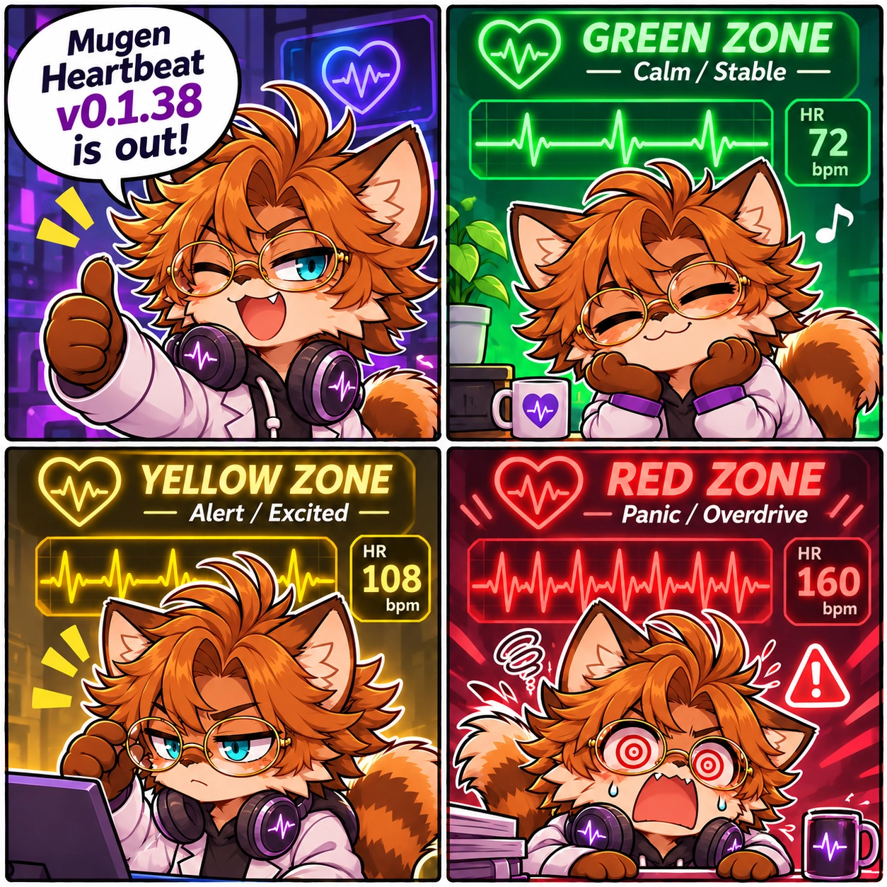
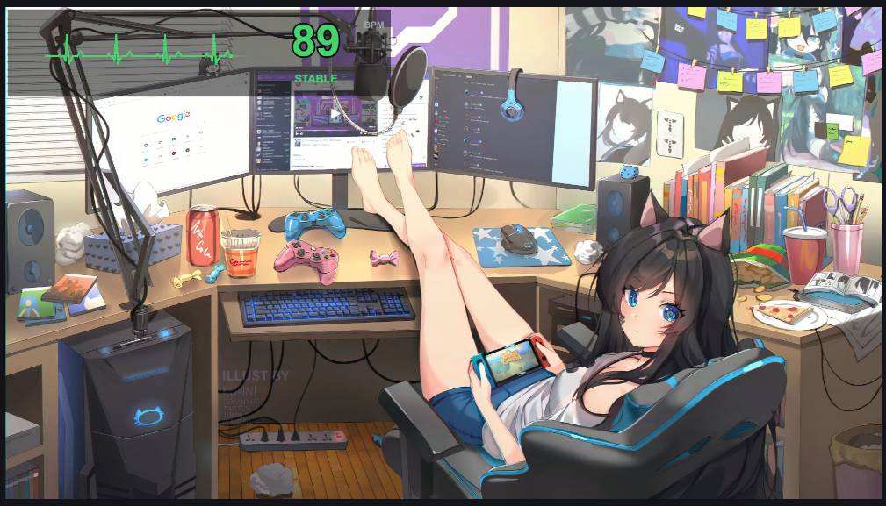
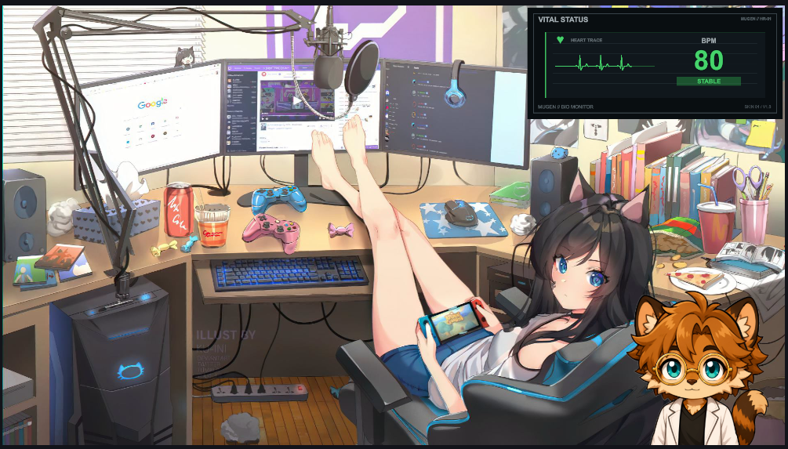
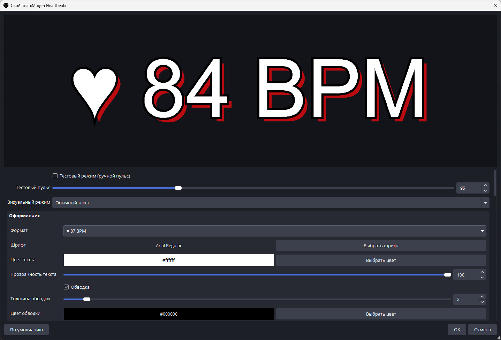
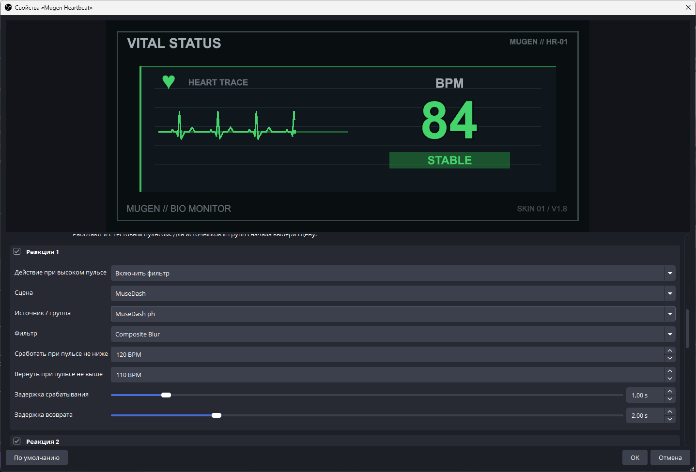
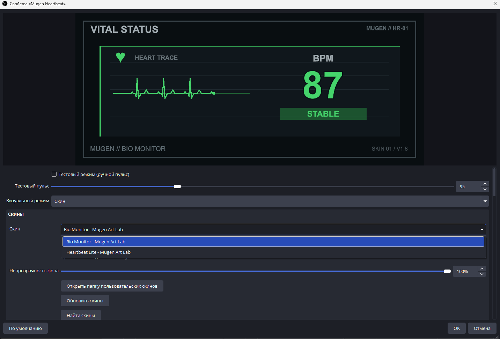

# Mugen Heartbeat

[English README](README.md)

**No account. No cloud. No subscription. Just your heartbeat.**

Mugen Heartbeat — нативный локальный источник пульса для OBS Studio под
Windows. Плагин напрямую подключается к совместимому Bluetooth Low Energy
устройству и передаёт живой BPM в OBS без аккаунта, облачного сервиса,
браузерного источника и подписки.

Текущее устройство, проверенное на реальном железе: **Xiaomi Smart Band 10**.

  

<em>От спокойствия до полного хаоса — твой пульс в OBS!</em>

## Скриншоты

### Heartbeat Lite

Компактный HUD, который не занимает пол-экрана во время игры.

### Bio Monitor

Крупный монитор жизненных показателей, заодно показывающий возможности движка скинов.

## Требования

- Windows 10 или Windows 11, x64;
- OBS Studio x64;
- Bluetooth Low Energy;
- устройство, которое передаёт стандартный BLE Heart Rate Service и
  характеристику Heart Rate Measurement.

Если браслет или часы требуют отдельно включить режим передачи/шаринга пульса,
его необходимо включить на самом устройстве.

## Скачать

Готовые сборки публикуются во вложениях к GitHub Releases.

Выбирай пакет в зависимости от того, как установлена OBS:

- **Windows Setup EXE (рекомендуется)** — установка через мастер в стандартную папку плагинов OBS.
- **Windows x64 ZIP** — ручная установка в стандартную папку плагинов OBS.
- **Windows x64 Portable ZIP** — распаковка прямо в корень портативной OBS. Внутри есть структура для OBS 32 и для OBS 33+.

Подробная инструкция по установке, обновлению и удалению — в [INSTALL-RU.md](INSTALL-RU.md).

Автоматические архивы **Source code**, создаваемые GitHub, содержат исходники
проекта, а не готовый к установке OBS-плагин.

## Основные возможности

- прямое локальное получение пульса по BLE в OBS;
- автоматическое подключение к сохранённому устройству и восстановление связи;
- watchdog для зависшего или пропавшего потока измерений;
- ручной тестовый BPM для настройки сцен без надетого датчика;
- обычный текстовый режим с числом, BPM, сердцем и собственным форматом;
- переменные `{bpm}` / `{heart}` и разметка `[pulse]...[/pulse]` для пульсации
  только выбранной части текста;
- анимация в такт сердцебиению с автоматическим использованием RR-интервалов,
  если устройство их передаёт;
- MTSDF-рендеринг текста со шрифтом, цветом, непрозрачностью, обводкой и тенью;
- до трёх реакций на пульс с гистерезисом и отдельными задержками
  срабатывания/возврата;
- реакции умеют показывать/скрывать источник или группу и включать/выключать
  фильтр OBS;
- встроенные скины **Bio Monitor** и **Heartbeat Lite**;
- пользовательский/community-формат скинов с текстом, прямоугольниками, ЭКГ,
  зонами BPM, пульсацией элементов, локализованными метаданными и
  настраиваемой непрозрачностью фона;
- интерфейс и документация скинов на русском и английском.

## Установка

### Установщик — рекомендуется

1. Полностью закрой OBS Studio.
2. Запусти `Mugen-Heartbeat-<version>-Windows-x64-Setup.exe`.
3. Запусти OBS Studio.
4. Добавь новый источник **Mugen Heartbeat**.

Обычная общая папка установки:

`C:\ProgramData\obs-studio\plugins\mugen-heartbeat`

Ручная установка, обновление, удаление и диагностика описаны в
[INSTALL-RU.md](INSTALL-RU.md).

## Совместимость устройств

Mugen Heartbeat использует стандартный BLE Heart Rate Service (`0x180D`) и
характеристику Heart Rate Measurement (`0x2A37`).

**Проверено на реальном устройстве для первого релиза:**

- Xiaomi Smart Band 10.

Другие часы, браслеты и пульсометры с тем же стандартным BLE-сервисом могут
работать, но до проверки на реальном железе считаются неподтверждёнными.

## Обычный текстовый режим

Скины необязательны. Mugen Heartbeat умеет работать и как компактный текстовый
источник со своим форматом, шрифтом, цветом, непрозрачностью, обводкой и тенью.

## Реакции на пульс

Для одного источника Mugen Heartbeat можно настроить до трёх реакций. Реакция
может:

- показать или скрыть источник/группу OBS;
- включить или выключить фильтр;
- иметь отдельный BPM для срабатывания и возврата;
- иметь отдельные задержки срабатывания и возврата.

Раздельные пороги дают гистерезис и не позволяют реакции дёргаться туда-сюда,
когда BPM колеблется около одного значения.

## Скины

Вместе с плагином идут два встроенных скина:

- **Bio Monitor** — крупный монитор жизненных показателей в духе survival horror;
- **Heartbeat Lite** — компактный HUD для стрима.

Пользовательские скины хранятся отдельно от установленного плагина и не
перезаписываются при его обновлении.

Mugen Heartbeat автоматически поддерживает в пользовательской папке двуязычную
документацию формата.

Смотри:

- [SKIN-FORMAT.ru.md](SKIN-FORMAT.ru.md) — формат скинов на русском;
- [SKIN-FORMAT.md](SKIN-FORMAT.md) — формат скинов на английском.

## Известные ограничения

- в первом релизе поддерживается только Windows x64;
- на реальном железе пока подтверждён Xiaomi Smart Band 10;
- устройство должно именно передавать пульс через стандартный BLE
  broadcast/sharing-режим; обычного измерения пульса только на экране устройства
  недостаточно;
- Mugen Heartbeat предназначен для стримов и визуализации, а не для медицинского
  мониторинга или диагностики.

## Сборка из исходников

Репозиторий использует CMake-инфраструктуру официального OBS plugin template и
фиксирует зависимости OBS в `buildspec.json`.

Инструкция для Windows: [docs/BUILDING-RU.md](docs/BUILDING-RU.md).

## Карта репозитория

- `src/` — нативный OBS-источник, BLE-логика, реакции и рендереры;
- `data/` — локализация OBS, effect-файл, встроенные скины и устанавливаемая
  документация;
- `cmake/` и `build-aux/` — инфраструктура сборки OBS plugin template;
- `docs/` — документация по сборке;
- `LICENSES/` — тексты лицензий сторонних компонентов;
- `previews/` — скриншоты и визуальные примеры для README;
- `installer/` — исходники двуязычного установщика Inno Setup;
- `tools/` — локальные скрипты сборки и упаковки релиза.

Для сборки и упаковки Windows-релиза запусти `BUILD_RELEASE.cmd`.

## Конфиденциальность

Пульс считывается локально по Bluetooth и локально отрисовывается внутри OBS.
Mugen Heartbeat не требует аккаунта, облачного сервиса, телеметрии или подписки
и не отправляет измерения пульса в интернет.

Кнопка **«Найти скины»** только открывает страницу проекта Mugen Heartbeat в
системном браузере.

## Раскрытие использования ИИ

Mugen Heartbeat разработан Mugen Art Lab при существенной помощи OpenAI ChatGPT
в генерации кода, отладке, документации и подготовке релизных инструментов.
Направление проекта, выбор функций, тестирование на реальном железе, визуальная
оценка, проверка и ответственность за релиз остаются за Mugen Art Lab.

Подробнее: [AI-DISCLOSURE.md](AI-DISCLOSURE.md).

## Ошибки и поддержка

Воспроизводимые ошибки можно сообщать через GitHub Issues. Что приложить к
сообщению, описано в [SUPPORT.md](SUPPORT.md); при проблемах с BLE или загрузкой
плагина особенно полезен журнал OBS.

## Лицензия

Mugen Heartbeat — свободное ПО с открытым исходным кодом под лицензией
**GPL-2.0-or-later**. См. [LICENSE](LICENSE).

MTSDF-рендерер использует `msdfgen-core` v1.13 под MIT License. См.
[THIRD-PARTY-NOTICES.md](THIRD-PARTY-NOTICES.md) и
[LICENSES/msdfgen-MIT.txt](LICENSES/msdfgen-MIT.txt).

Mugen Heartbeat — независимый сторонний плагин, не связанный с OBS Project и не
одобренный им.
