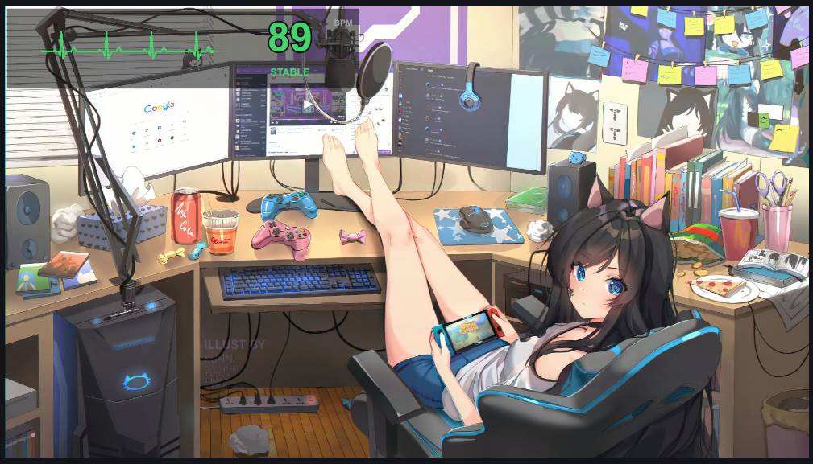
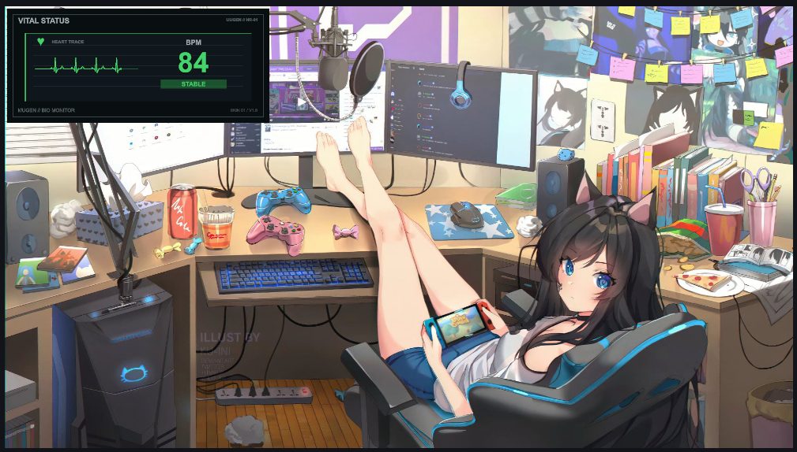
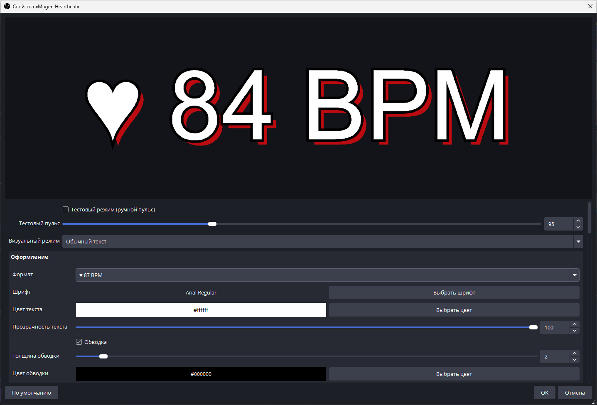
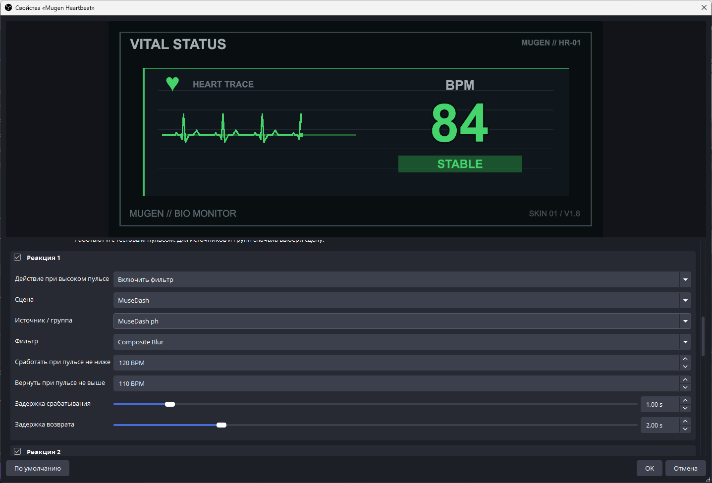
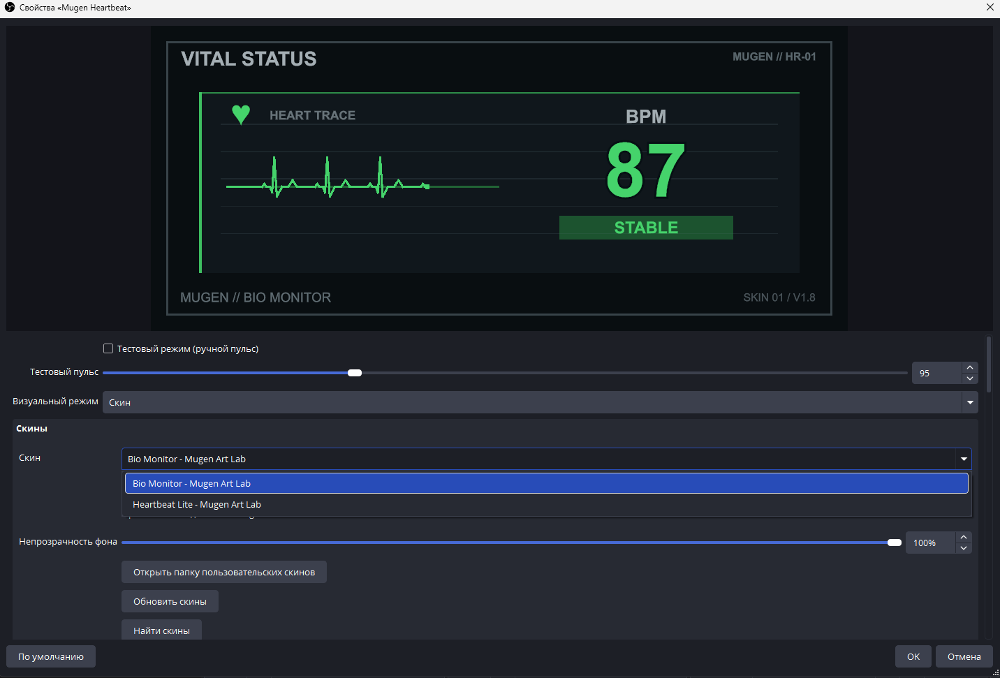

# Mugen Heartbeat

[Русская версия](README-RU.md)

**No account. No cloud. No subscription. Just your heartbeat.**

Mugen Heartbeat is a native local heart-rate source for OBS Studio on Windows.
It connects directly to compatible Bluetooth Low Energy heart-rate devices and
brings live BPM into OBS without an account, cloud service, browser source, or
subscription.

The current hardware-verified target is **Xiaomi Smart Band 10**.

## Preview

### Heartbeat Lite

A compact HUD intended to stay out of the way during gameplay.

### Bio Monitor

A larger vital-sign display that also demonstrates the skin engine.

## Requirements

- Windows 10 or Windows 11, x64;
- OBS Studio x64;
- Bluetooth Low Energy;
- a device that exposes the standard BLE Heart Rate Service and Heart Rate
  Measurement characteristic.

Device-specific heart-rate sharing/broadcast mode must be enabled when required
by the wearable.

## Download

Release builds are distributed through GitHub Releases.

The recommended package is the Windows installer. A manual ZIP package is also
provided for users who prefer to inspect and install the plugin themselves.

GitHub's automatically generated **Source code** archives contain the project
source, not a ready-to-install OBS plugin.

## Highlights

- direct local BLE heart-rate input into OBS;
- automatic connection to a saved device and reconnect handling;
- measurement watchdog for stalled or unavailable heart-rate streams;
- manual BPM test mode for configuring scenes without wearing the sensor;
- plain-text mode with number, BPM, heart-symbol and custom formats;
- `{bpm}` / `{heart}` variables and `[pulse]...[/pulse]` selective pulse markup;
- beat-synced animation with RR intervals used automatically when the device
  provides them;
- MTSDF text rendering with font, color, opacity, outline and shadow controls;
- up to three heart-rate reactions with hysteresis and independent trigger/reset
  delays;
- reactions can show/hide a source or group, or enable/disable an OBS filter;
- built-in **Bio Monitor** and **Heartbeat Lite** skins;
- user/community skin format with text, rectangle and ECG elements, BPM zones,
  pulse animation, localized metadata and per-skin background opacity;
- English and Russian UI and skin documentation.

## Installation

### Installer — recommended

1. Close OBS Studio completely.
2. Run `Mugen-Heartbeat-<version>-Windows-x64-Setup.exe`.
3. Start OBS Studio.
4. Add a new **Mugen Heartbeat** source.

The normal all-users plugin location is:

`C:\ProgramData\obs-studio\plugins\mugen-heartbeat`

Manual installation, updating, removal and troubleshooting are described in
[INSTALL.md](INSTALL.md).

## Device compatibility

Mugen Heartbeat uses the standard BLE Heart Rate Service (`0x180D`) and Heart
Rate Measurement characteristic (`0x2A37`).

**Verified hardware for the initial release:**

- Xiaomi Smart Band 10.

Other wearables and heart-rate sensors that expose the same standard BLE service
may work, but should be treated as unverified until tested on real hardware.

## Plain text mode

Skins are optional. Mugen Heartbeat can also render a compact text source with
custom format, font, color, opacity, outline and shadow settings.

## Heart-rate reactions

Each Mugen Heartbeat source can configure up to three reactions. A reaction can:

- show or hide an OBS source/group;
- enable or disable a filter;
- use separate trigger and reset BPM values;
- use separate trigger and reset delays.

The separate trigger/reset thresholds provide hysteresis so a reaction does not
rapidly flap when BPM hovers around one value.

## Skins

The plugin ships with two built-in skins:

- **Bio Monitor** — a larger survival-horror-inspired vital-sign display;
- **Heartbeat Lite** — a compact stream HUD.

User skins are stored separately from the installed plugin and are not replaced
when the plugin is updated.

The user-skin folder contains bilingual documentation automatically maintained
by Mugen Heartbeat.

See:

- [SKIN-FORMAT.md](SKIN-FORMAT.md) — English skin format reference;
- [SKIN-FORMAT.ru.md](SKIN-FORMAT.ru.md) — Russian skin format reference.

## Known limits

- Windows x64 only in the initial release;
- hardware compatibility is currently verified only with Xiaomi Smart Band 10;
- a wearable must expose heart-rate data over standard BLE HR broadcasting /
  sharing; ordinary on-device heart-rate monitoring alone is not sufficient;
- Mugen Heartbeat is intended for streaming and visualization, not for medical
  monitoring or diagnosis.

## Building from source

The repository uses the OBS plugin-template CMake infrastructure and pins the
OBS build dependencies in `buildspec.json`.

Windows build instructions are in [docs/BUILDING.md](docs/BUILDING.md).

## Repository map

- `src/` — native OBS source, BLE logic, reactions and renderers;
- `data/` — OBS localization, shader/effect data, built-in skins and installed
  documentation;
- `cmake/` and `build-aux/` — OBS plugin-template build infrastructure;
- `docs/` — build documentation;
- `LICENSES/` — third-party license texts;
- `installer/` — bilingual Inno Setup installer sources;
- `tools/` — local build and release packaging scripts.

Run `BUILD_RELEASE.cmd` to build and package the Windows release.

## Privacy

Heart-rate data is read locally over Bluetooth and rendered locally inside OBS.
Mugen Heartbeat does not require an account, cloud service, telemetry service,
or subscription and does not upload heart-rate measurements.

The **Find skins** button only opens the Mugen Heartbeat project page in the
system web browser.

## AI development disclosure

Mugen Heartbeat was developed by Mugen Art Lab with substantial assistance from
OpenAI ChatGPT for code generation, debugging, documentation and release
tooling. Project direction, feature decisions, real-device testing, visual
evaluation, validation and release responsibility remain with Mugen Art Lab.

See [AI-DISCLOSURE.md](AI-DISCLOSURE.md).

## Support and issues

Report reproducible bugs through the GitHub issue tracker. Please include the
information listed in [SUPPORT.md](SUPPORT.md), especially the OBS log for BLE
or loading problems.

## License

Mugen Heartbeat is free and open-source software licensed under
**GPL-2.0-or-later**. See [LICENSE](LICENSE).

The MTSDF renderer uses `msdfgen-core` v1.13 under the MIT License. See
[THIRD-PARTY-NOTICES.md](THIRD-PARTY-NOTICES.md) and
[LICENSES/msdfgen-MIT.txt](LICENSES/msdfgen-MIT.txt).

Mugen Heartbeat is an independent third-party plugin and is not affiliated with
or endorsed by the OBS Project.
